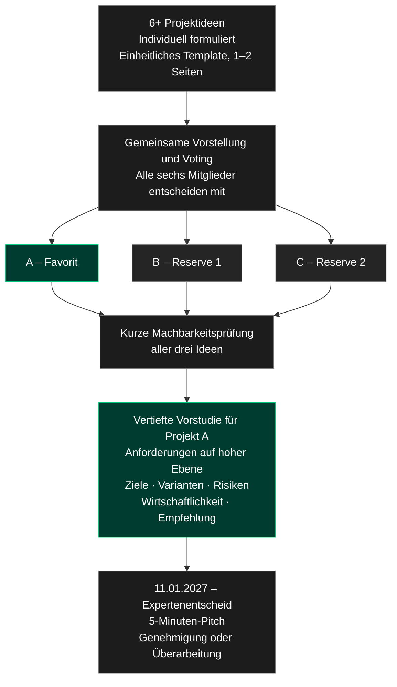

# Phase 1 – Vorstudie

## Ziel

Sammlung, Bewertung und Auswahl einer geeigneten
Projektidee für das interdisziplinäre Teamprojekt.
Eine Vorstudie ist nicht einfach nur eine Ideesammlung. Sie ist ein strukturiertes Entscheidungsprozess, der begründet, ob und wie ein Projekt weiterverfolgt werden soll.

Ziel ist es, eine Idee/Vision in den Vorstudienprozess einzubringen und mithilfe klarer Ziele, Projektabgrenzungen, Risiken, Lösungsvarianten zu erkennen, ob sie realisierbar ist und somit reif für ein Projekt ist.

## Gesammtmodell

## Vorgehensweise

1. Mindestens sechs Projektideen dokumentieren.
   _[Zu => Schritt eins](Projektmanagment/projekt_ideen.md)_
2. Alle Ideen gemeinsam vorstellen.
   _[Zu => Schritt zwei](Projektmanagment/idee_vorstellen.md)_
3. Voting durchführen.
   _[Zu => Schritt drei](Projektmanagment/voting_idee.md)_
4. Die drei besten Ideen auswählen.
   _[Zu => Schritt vier](Projektmanagment/top_idee.md)_
5. Hauptidee A umfassende Vostudie.
   _[Zu => Schritt fünf](Projektmanagment/vosrtudie_idee.md)_
6. Elevator Pitch für den Expertenentscheid vorbereiten.
   _[Zu => Schritt sechs](Projektmanagment/elevator_pitch.md)_

## Projektorganisation

- [Templates](Templates/)
- [Ideensammlung](Ideen/)
- [Projektmanagement](Projektmanagement/)
- [Sitzungsprotokolle](Protokolle/)
- [Top 3 Projektideen](Top3/)

## Meilenstein

M1 – Vorstellung der Projektidee: 11.01.2027
